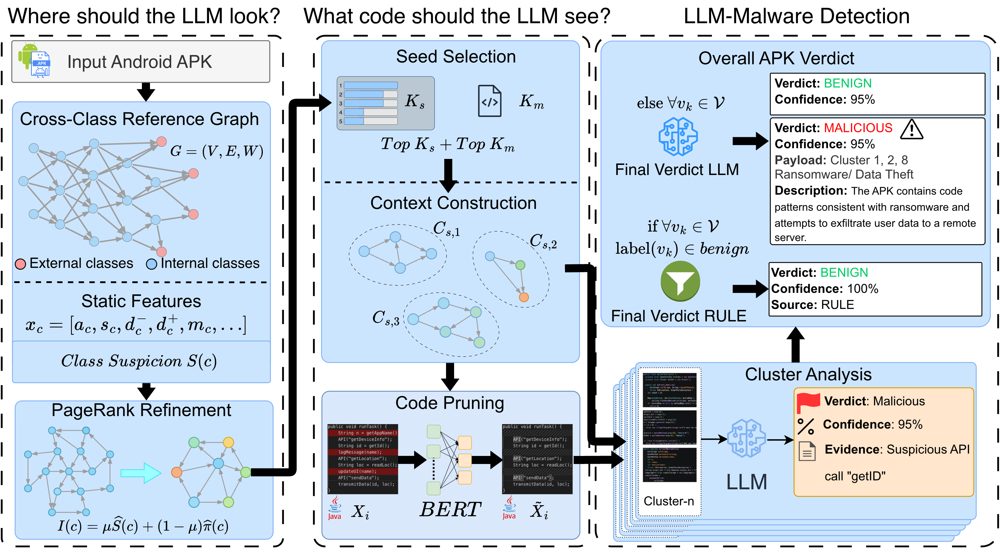

# MalLens

**Token-efficient, LLM-based Android malware detection.**

MalLens takes an APK, builds a class-level call graph, scores and groups the
most suspicious classes into token-budgeted clusters, prunes each cluster down
to its most informative code, and asks a local LLM (served by
[Ollama](https://ollama.com)) to judge each cluster. A final aggregation step
turns the cluster verdicts into a single APK-level verdict
(`malicious` / `benign`) with a confidence score and supporting evidence.

---

## Table of contents

1. [Architecture](#architecture)
2. [Repository structure](#repository-structure)
3. [Requirements](#requirements)
4. [Installation](#installation)
5. [Configuration](#configuration)
6. [Running MalLens](#running-mallens)
7. [Evaluating on a dataset (`evaluate_analysis2.py`)](#evaluating-on-a-dataset-evaluate_analysis2py)
8. [Outputs](#outputs)
9. [Troubleshooting](#troubleshooting)

---

## Architecture

<!--
  TODO: add the architecture diagram here, e.g.
  1. save the image as docs/images/architecture.png
  2. keep the line below (it will render automatically)
-->




The pipeline run by `scripts/06_llm_report.py` has five cache-aware stages:

| Stage | What it does | Code |
|------:|--------------|------|
| 1 | Parse the APK with Androguard and build a class-level call graph; classify each class as app / framework / library | `src/mallens/ingest/` |
| 2 | Decompile with **jadx**, extract per-class features (sensitive APIs, strings/entropy, manifest, ATT&CK-style suspicion signals, app role) | `src/mallens/features/` |
| 3 | Score class importance (PageRank by default) and grow token-budgeted clusters around the top seeds | `src/mallens/importance/`, `src/mallens/clustering/` |
| 4 | Prune each cluster's source with a saliency model (GraphCodeBERT) and query the LLM for a per-cluster verdict | `src/mallens/llm/`, `src/mallens/slicer/` |
| 5 | Aggregate cluster verdicts into one APK verdict with the LLM (a rule engine runs in "shadow" mode for comparison) | `src/mallens/report/` |

Every expensive stage is cached by the APK's SHA-256, so re-running an APK does
not repeat work unless you pass `--force`.

---

## Repository structure

```text
MalLens/
├── README.md
├── requirements.txt            # pinned Python dependencies
├── pyproject.toml              # registers the `mallens` package (pip install -e .)
├── evaluate_analysis2.py       # batch evaluation over a benign/malware dataset
│
├── configs/
│   └── default.yaml            # all paths, thresholds, LLM and report settings
│
├── data/
│   ├── sensitive_apis.csv      # sensitive-API patterns with category/weight/permission
│   └── sens.txt                # sensitive-API list (plain text)
│
├── scripts/                    # entry points (run from the repo root)
│   ├── 01_build_graph.py       # stage 1 only
│   ├── 02_extract_features.py  # stages 1-2
│   ├── 03_rank_clusters.py     # stages 1-3
│   ├── 04_llm_analyze.py       # stages 1-4 (per-cluster LLM verdicts)
│   ├── 04a_factsheets.py       # alternative pipeline: per-class fact sheets
│   ├── 04b_pathverdicts.py     # alternative pipeline: source->sink path adjudication
│   ├── 05_report.py            # earlier end-to-end run with the rule engine
│   ├── 06_llm_report.py        # MAIN end-to-end pipeline (used by evaluate_analysis2.py)
│   ├── 07_path_report.py       # end-to-end fact-sheet / path-based pipeline
│   └── misc/                   # one-off experiment and analysis scripts
│
└── src/mallens/                # the Python package
    ├── config.py               # pydantic config model (loads configs/*.yaml)
    ├── core/                   # dataclasses for stage results, exceptions
    ├── ingest/                 # stage 1: APK -> class graph (Androguard in a child process)
    ├── features/               # stage 2: jadx wrapper, manifest, strings, API taxonomy, ATT&CK signals
    ├── importance/             # stage 3: importance scorers (naive | pagerank | propagation)
    ├── clustering/             # stage 3: seed selection and budgeted cluster expansion
    ├── llm/                    # stage 4: prompts, Ollama/OpenAI clients, code packing, fact sheets
    ├── slicer/                 # code pruning / saliency slicing (+ experimental slicers)
    ├── report/                 # stage 5: LLM aggregation, rule engine, report rendering
    ├── summarization/          # experimental class-summary prompts and verification
    ├── tpl/                    # experimental third-party-library detection (FAISS + MiniLM)
    ├── eval/                   # evaluation helpers
    └── utils/                  # sha256 artifact cache, logging, Java pre-processing
```

Directories created at run time (safe to delete, and best kept out of git):

```text
.mallens_cache_*/                              # per-APK stage cache (see paths.cache_dir)
<paths.cache_dir_decomp>/                      # jadx / apktool output
reports_*/<sha256[:12]>/                       # verdict.json + report.md (see report.out_dir)
Stage4Results-System_*/<sha256>/               # raw per-cluster LLM inputs and outputs
global_logfiles/pipeline.log                   # rotating log
evaluation_results_*.csv                       # per-APK results from evaluate_analysis2.py
```

---

## Requirements

### Hardware and OS

- Linux (developed and run on Linux).
- An NVIDIA GPU is strongly recommended: it serves the Ollama model and
  accelerates the saliency pruning model. PyTorch falls back to CPU (with a
  warning) if no GPU is found, but this is slow.
- Enough free disk space for the jadx output and caches. They grow with every
  APK you analyse.

### Tools that must be installed

| Tool | Used for | Version |
|------|----------|---------|
| Python | runtime | **3.10** |
| Java (JRE/JDK) | required by jadx and Apktool | `<fill in: output of java -version>` |
| [jadx](https://github.com/skylot/jadx) | decompiles APKs to Java source (stage 2) | `<fill in: output of jadx --version>` |
| [Apktool](https://apktool.org) | smali / resource decoding | `<fill in: output of apktool --version>` |
| [Ollama](https://ollama.com) | serves the LLM at `http://localhost:11434` | `<fill in: output of ollama --version>` |
| NVIDIA driver + CUDA | GPU acceleration for PyTorch | `<fill in: nvidia-smi>`; PyTorch wheel is built for CUDA 12.9 |
| git | cloning the repo | any recent version |

`jadx` and `apktool` must be on your `PATH`, or you must point to them in
`configs/default.yaml` (`paths.jadx_binary`, `paths.apktool_binary`).

### Models

| Model | Where it comes from | Used for |
|-------|---------------------|----------|
| `qwen3-coder:latest` | `ollama pull qwen3-coder:latest` | cluster analysis and final aggregation (`llm.model` in the config) |
| `microsoft/graphcodebert-base` | downloaded automatically from Hugging Face on first run | saliency-based code pruning |

### Key Python packages (pinned in `requirements.txt`)

| Package | Version |
|---------|---------|
| androguard | 4.1.4 |
| torch | 2.13.0 |
| transformers | 5.16.0 |
| numpy | 2.2.6 |
| networkx | 3.4.2 |
| pydantic | 2.13.4 |
| PyYAML | 6.0.3 |
| loguru | 0.7.3 |
| requests | 2.34.2 |
| pandas | 2.3.3 |
| matplotlib | 3.10.9 |

Optional, only for the experimental `tpl/` and `slicer/` modules (not needed
for the main pipeline): `faiss-cpu`, `scikit-learn`, `sentence-transformers`,
`javalang`.

---

## Installation

```bash
# 1. Clone
git clone https://github.com/akilanir/MalLens.git
cd MalLens

# 2. Create a Python 3.10 environment
python3.10 -m venv .venv
source .venv/bin/activate
python -m pip install --upgrade pip

# 3. Install the pinned dependencies
pip install -r requirements.txt

# 4. Install MalLens itself (editable) so `import mallens` works from anywhere
pip install -e .
```

> **No `pip install -e .`?** You can run everything from the repo root with
> `export PYTHONPATH="$PWD/src"` instead.

**Install jadx, Apktool and Java** with your package manager or from their
release pages, then check:

```bash
java -version
jadx --version
apktool --version
```

**Install Ollama and pull the model:**

```bash
ollama --version
ollama pull qwen3-coder:latest
ollama serve        # skip if Ollama already runs as a service; it listens on :11434
```

**Pre-download the pruning model** (optional but recommended on machines that
are offline during runs):

```bash
python -c "from transformers import AutoModel, AutoTokenizer; \
AutoTokenizer.from_pretrained('microsoft/graphcodebert-base'); \
AutoModel.from_pretrained('microsoft/graphcodebert-base')"
```

---

## Configuration

All settings live in `configs/default.yaml`. Before the first run, check these:

| Key | Default | What to change |
|-----|---------|----------------|
| `paths.cache_dir` | `.mallens_cache_aggObfLarge` | where stage caches are stored |
| `paths.cache_dir_decomp` | `/srv/akila/mallens/.mallens_cache_decomp` | **absolute path on the original machine; change it** to a directory you can write to |
| `paths.jadx_binary` | `jadx` | full path if jadx is not on `PATH` |
| `paths.apktool_binary` | `apktool` | full path if apktool is not on `PATH` |
| `llm.base_url` | `http://localhost:11434` | your Ollama endpoint |
| `llm.model` | `qwen3-coder:latest` | any model available in Ollama |
| `report.out_dir` | `reports_aggObfLarge` | where reports are written; must match `REPORT_DIR` in `evaluate_analysis2.py` |

> **Always run commands from the repository root.** Several modules load
> `configs/default.yaml` and `data/sensitive_apis.csv` through relative paths.

---

## Running MalLens

### Analyse a single APK

```bash
python scripts/06_llm_report.py --config configs/default.yaml --force /path/to/app.apk
```

Pass several APKs to analyse them in one run. Drop `--force` to reuse cached
stages. The verdict is printed to the log and saved under
`reports_aggObfLarge/<first 12 chars of the APK's sha256>/`.

### Run the stages one by one (debugging)

```bash
python scripts/01_build_graph.py     --config configs/default.yaml app.apk   # stage 1
python scripts/02_extract_features.py --config configs/default.yaml app.apk  # stages 1-2
python scripts/03_rank_clusters.py    --config configs/default.yaml app.apk  # stages 1-3
python scripts/04_llm_analyze.py      --config configs/default.yaml app.apk  # stages 1-4
```

---

## Evaluating on a dataset (`evaluate_analysis2.py`)

`evaluate_analysis2.py` runs MalLens over a labelled dataset and reports
accuracy, precision, recall and F1.

### 1. Arrange the dataset

The folder name is the ground-truth label. APKs are found recursively.

```text
dataset_root/
├── benign/        # every *.apk here is labelled BENIGN
│   └── ...
└── malware/       # every *.apk here is labelled MALICIOUS
    └── ...
```

The folder list is the `folders = [...]` line inside `evaluate()` in
`evaluate_analysis2.py`. Edit it to evaluate other sub-folders. The ground truth
is `BENIGN` when the folder is named `benign` or `benign_2025`, and `MALICIOUS`
otherwise.

### 2. Make sure the prerequisites are running

- Ollama is serving the model in `llm.model`.
- `jadx` and `apktool` work from your shell.
- You are in the repo root with the virtual environment activated, because the
  script launches `python scripts/06_llm_report.py` as a subprocess.

### 3. Run

```bash
python evaluate_analysis2.py --root /path/to/dataset_root --config configs/default.yaml
```

| Argument | Required | Default | Meaning |
|----------|----------|---------|---------|
| `--root` | yes | n/a | dataset root containing `benign/` and `malware/` |
| `--config` | no | `configs/default.yaml` | config passed to `06_llm_report.py` |

### How it works

For each APK, the script:

1. Computes the APK's SHA-256 and looks for
   `reports_aggObfLarge/<sha256[:12]>/verdict.json`.
2. If the report exists, it reads the verdict from it (no LLM call). This makes
   an interrupted run **resumable**.
3. If it does not exist, it runs
   `python scripts/06_llm_report.py --config <config> --force <apk>` and then
   reads the new `verdict.json`.
4. If there is still no report, or no verdict, the APK counts as `UNKNOWN`.
5. It updates the confusion matrix.

### Scoring rules

| Ground truth | Prediction | Counted as |
|--------------|-----------|------------|
| MALICIOUS | MALICIOUS | TP |
| MALICIOUS | anything else (BENIGN, SUSPICIOUS, UNKNOWN) | FN |
| BENIGN | BENIGN or SUSPICIOUS | TN |
| BENIGN | anything else (MALICIOUS, UNKNOWN) | FP |

### Output

At the end the script prints TP / FP / TN / FN, accuracy, precision, recall,
F1, the number of APKs analysed, and the total and average time per APK. It
also writes `evaluation_results_aggObfLarge.csv` with one row per APK:
`APK, Folder, GroundTruth, Prediction, Time(s)`.

Time per APK is measured on this run, so APKs served from an existing report
show near-zero time.

### Settings you may need to edit

These constants are at the top of `evaluate_analysis2.py`:

```python
REPORT_DIR = "reports_aggObfLarge"               # must equal report.out_dir in the config
RESULT_CSV = "evaluation_results_aggObfLarge.csv"
```

To run a separate experiment without mixing results, change `REPORT_DIR` and
`report.out_dir` in the config together (and `RESULT_CSV` if you want a new
CSV). Use a different `paths.cache_dir` too, so the stage caches do not collide.

---

## Outputs

For each analysed APK, `report.out_dir/<sha256[:12]>/` contains:

| File | Content |
|------|---------|
| `verdict.json` | final verdict, confidence, payload clusters and description, family hint, malicious classes, key evidence, shadow rule-engine verdict |
| `report.md` | human-readable version of the same verdict |

---

## Troubleshooting

| Symptom | Likely cause and fix |
|---------|----------------------|
| `FileNotFoundError: configs/default.yaml` | you are not in the repo root |
| `ModuleNotFoundError: No module named 'mallens'` | run `pip install -e .`, or `export PYTHONPATH="$PWD/src"` |
| `jadx binary not found` in the log | install jadx and add it to `PATH`, or set `paths.jadx_binary` |
| `Ollama request failed` / connection refused | start Ollama (`ollama serve`) and check `llm.base_url` |
| model not found in Ollama | `ollama pull <model>` for the name in `llm.model` |
| `PermissionError` creating the decompile cache | change `paths.cache_dir_decomp` to a writable directory |
| `ERROR... WE COULDNT FIND THE REPORT` in the evaluation | `06_llm_report.py` failed for that APK; run it directly on the APK to see the error, and check that `REPORT_DIR` equals `report.out_dir` |
| Hugging Face download fails | pre-download `microsoft/graphcodebert-base` (see Installation) |
